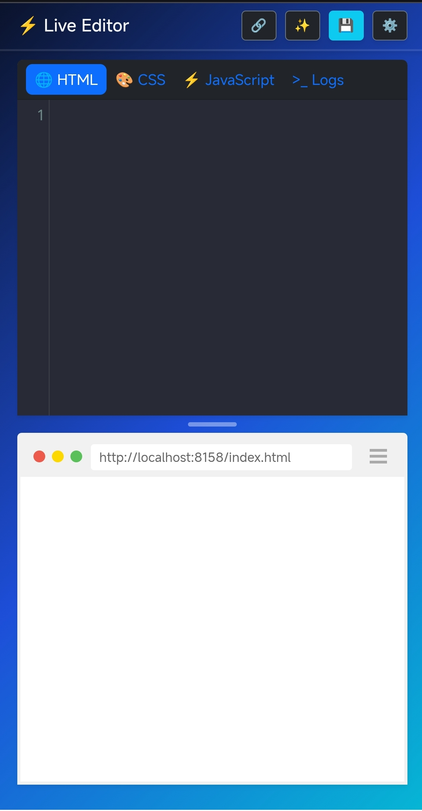
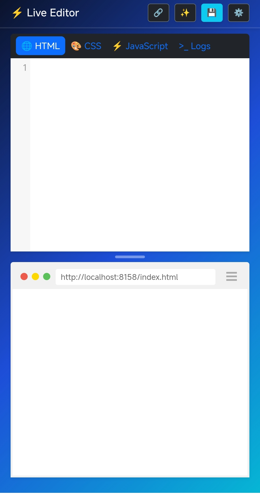

  

# ⚡ Mobile Sandbox IDE (Live Editor)

A lightweight, multi-tab web code sandbox application designed specifically for mobile and desktop developers. Built using native JavaScript, CodeMirror 5, and Bootstrap 5.

---

## 🔗 Live Demo

---

## ✨ Features

### 🧰 Smart Code Editing & Automation
- **Custom JSON Snippets Engine:** Load, edit, and save your custom shortcuts directly inside the JS Editor with auto-validation (e.g., `clg` → `console.log()`).
- **Enhanced Emmet & Dynamic Counter ($):** Expand Emmet abbreviations seamlessly (e.g., `h1{heading-$}` expands to `<h1>heading-1</h1>`, `ul>li*3>{Item $}` auto-numbers list items).
- **Auto Bracket & Tag Closing:** Automatic pair completion for brackets (`{}`, `()`, `[]`) and auto-closing HTML tags with clean indentation on `Enter`.

### 🎨 Color & Appearance Tools
- **Cursor Color Converter:** Convert color values (HEX ↔ RGB ↔ HSL) instantly at your editor cursor position or manually via the settings panel.
- **Font & Theme Customization:** Switch between coding fonts (*Fira Code, JetBrains Mono, Google Sans Code, Source Code Pro*), adjust font sizes, weights (300–700), line heights, font ligatures, and themes (*Dracula, Monokai*).
- **Instant CSS Framework Injection:** Toggle seamlessly between Vanilla CSS, Bootstrap 5.3, and Tailwind CSS without manual setup.

### ⚡ Live Preview & Debugging
- **Real-Time Rendering:** Instant iframe preview powered by `srcdoc` debounced for zero performance lag.
- **Smart Console Log & Line Navigation:** Integrated console for `log`, `warn`, `error`, and `info`. Click on any logged error line to jump straight to that line in the JS editor.
- **Draggable Splitter & Layout Swap:** Drag-to-resize editor/preview height ratio dynamically or flip layout position using the window toolbar toggle.

### 💾 Backup, Export & Sharing
- **URL Base64 Code Sharing:** Share complete HTML/CSS/JS state instantly via lightweight URL hash links.
- **Workspace Backup & Restore:** Export and restore full project state along with editor settings via `.json` files.
- **Single-File Export:** Download your project directly as a standalone `index.html` file with embedded styles, scripts, and CDNs.
- **Code Beautifier:** Single-click formatting for HTML, CSS, and JS using `JS-Beautify` (or `Alt + F` shortcut).

---

## 📦 Tech Stack

- HTML5
- CSS3
- JavaScript (ES6+)
- Bootstrap v5.3+
- CodeMirror 5
- JS-Beautify

---

## 📸 Screenshots

  
  

---

## 📜 License

This project is licensed under the MIT License.

You are free to:
- Use
- Modify
- Distribute
- Use commercially

As long as the original license and copyright notice are included.

See the `LICENSE` file for full details.

---

## 🤝 Acknowledgements

Live Editor was developed with the assistance of AI-powered development tools for guidance, debugging, and workflow support during development.

This project also leverages the following open-source libraries:
- **CodeMirror** — Syntax highlighting & code editing engine
- **JS-Beautify** — Multi-language code formatting
- **Bootstrap** — UI framework & layout structure
