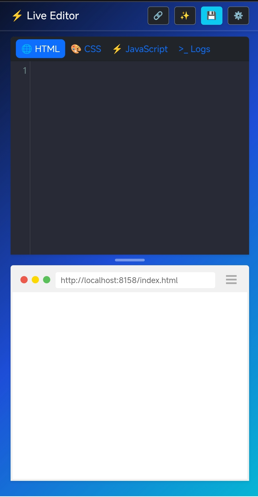
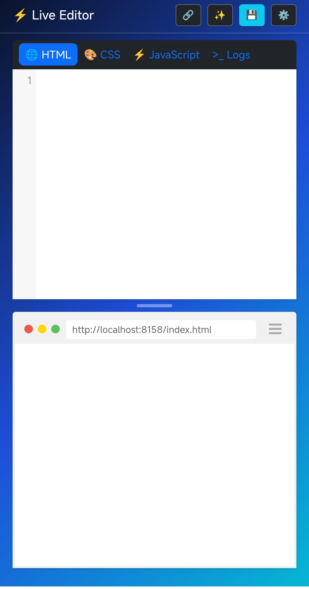

  

# ⚡ Mobile Sandbox IDE (Live Editor)

A lightweight, multi-tab web code sandbox application designed specifically for mobile and desktop developers. Built using native JavaScript, CodeMirror 5, and Bootstrap 5.

---

## 🔗 Live Demo

---

## Features

### 🚀 Power-User & Navigation Tools

- **⚡ VS Code Style Command Palette (`Alt + P` or `Ctrl + Shift + P`):** Lightning-fast command hub to toggle preferences (_Word Wrap, Line Numbers, Font Ligatures_), switch themes (_Dracula, Monokai, Default / Light_), change CSS frameworks (_Vanilla, Bootstrap, Tailwind_), clear individual editors or console, trigger Zen Modes, and run More Settings actions instantly without opening the settings drawer.
- **🗺️ Interactive Code Breadcrumbs:** Dynamic file path and selector hierarchy trail at the top of editors. Click any crumb to jump straight to that line, and it automatically hides when you switch to the Log tab.
- **🖥️ Zen Mode Layouts:** Fullscreen, distraction-free toggles for the Editor Panel or the Preview Panel, to maximise coding space on mobile and desktop.

### 🧰 Smart Code Editing & Automation

- **📂 Built-in Code Folding:** Clean gutter fold markers (`▼` / `▶`) with keyboard shortcuts (`Ctrl + Shift + [` / `]`, `0`, `9`) to collapse and expand code blocks, with no CodeMirror addon needed.
- **🔮 Advanced Emmet & Live Preview Popup:** Instant abbreviation expansion for HTML and CSS (_e.g., `df`, `jcc`, `aic`, `m10`, `bgc#333`, `w100p`_), plus a floating live preview that shows only while typing, never on tap, and never covers the active line.
- **📝 Custom JSON Snippets Engine:** Load, edit, and save your custom shortcuts directly inside the JS Editor with auto-validation (e.g., `clg` → `console.log()`) and `Alt + S` shortcut triggers. Your JS is backed up before editing and restored on save.
- **⌨️ Auto Bracket, Quote & Tag Closing:** Automatic pair completion for brackets (`{}`, `()`, `[]`), quotes (`""`, `''`) and backticks, plus auto-closing HTML tags with clean indentation on `Enter`.
- **💬 Multi-Language Comment Toggle (`Ctrl + /` or `Cmd + /`):** Instantly comment or uncomment the active line or selection across HTML (`<!-- -->`), CSS (`/* */`), and JavaScript (`//`).

### 🎨 Color & Appearance Tools

- **🎨 Cursor Color Converter:** Convert the color at your cursor, or a value you type, between HEX, RGB and HSL.
- **🌗 Adaptive Field Colors & Live Value Display:** The color input field dynamically updates its background, text, and border colors from the color value's brightness (YIQ formula), so the value stays readable.
- **🔤 Font & Theme Customization:** Switch between coding fonts (_Fira Code, JetBrains Mono, Google Sans Code, Source Code Pro_), adjust font size, weight (300–700), line height, font ligatures, and themes (_Dracula, Monokai, Default / Light_).
- **🧩 Instant CSS Framework Injection:** Switch between Vanilla CSS, Bootstrap 5.3, and Tailwind CSS without manual setup.

### ⚡ Live Preview & Debugging

- **👀 Real-Time Rendering:** Instant iframe preview powered by `srcdoc`, debounced so typing stays smooth.
- **🐞 Console & Mobile Devtools (Eruda):** Integrated error logging and console routing with an Eruda mobile inspector toggle. Click any logged error line to jump straight to that line in the JS editor, with a temporary highlight.
- **📦 Offline Eruda (No CDN Needed):** Eruda loads from a local bundled file, so the inspector works even without internet.
- **🗃️ Eruda Resources Panel:** Inspect Local Storage, Session Storage, Cookies, Scripts, Stylesheets, Iframes, and Images right inside the preview — values persist across preview rebuilds.
- **↔️ Draggable Splitter & Auto-Saved Layout Position:** Drag to resize the editor/preview height ratio, or flip the layout with the toolbar toggle. The layout orientation auto-saves across refreshes, while the splitter size resets gracefully.

### 💾 Backup, Export & Sharing

- **🔗 URL Base64 Code Sharing:** Share the full HTML/CSS/JS state in one lightweight URL hash link (`#code=...`).
- **💾 Workspace Backup & Restore:** Export and restore the full project state, including editor settings, via `.json` files.
- **💾 Auto-Save:** Your code auto-saves to localStorage, so a refresh never loses your work.
- **🧹 Reset All Data:** Wipe all saved code and settings in one action.
- **📄 Single-File Export:** Download your project as a standalone `index.html` file with embedded styles, scripts, and framework CDNs. Eruda stays preview-only and is not included in the export.
- **👁️ View Source in New Tab:** Open the current project in a new tab.
- **✨ Code Beautifier:** One-click formatting for HTML, CSS, and JS using `JS-Beautify` (or `Alt + F` shortcut).

---

## 📦 Tech Stack

- HTML5
- CSS3
- JavaScript (ES6+)
- Bootstrap v5.3+
- CodeMirror 5
- JS-Beautify

---

## 📸 Screenshots

  
  

---

## 📜 License

This project is licensed under the MIT License.

You are free to:

- Use
- Modify
- Distribute
- Use commercially

As long as the original license and copyright notice are included.

See the `LICENSE` file for full details.

---

## 🤝 Acknowledgements

Live Editor was developed with the assistance of AI-powered development tools for guidance, debugging, and workflow support during development.

This project also leverages the following open-source libraries:

- **CodeMirror** — Syntax highlighting & code editing engine
- **JS-Beautify** — Multi-language code formatting
- **Bootstrap** — UI framework & layout structure
